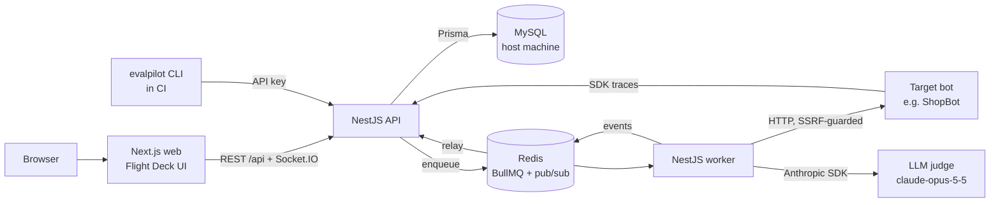
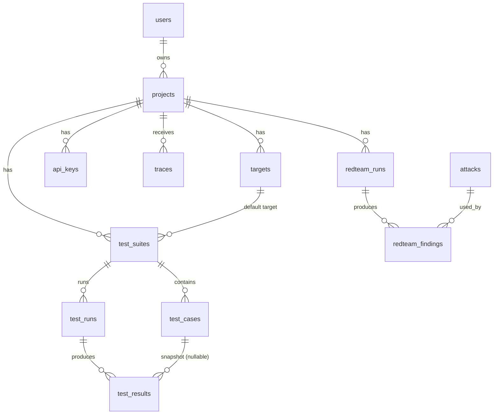
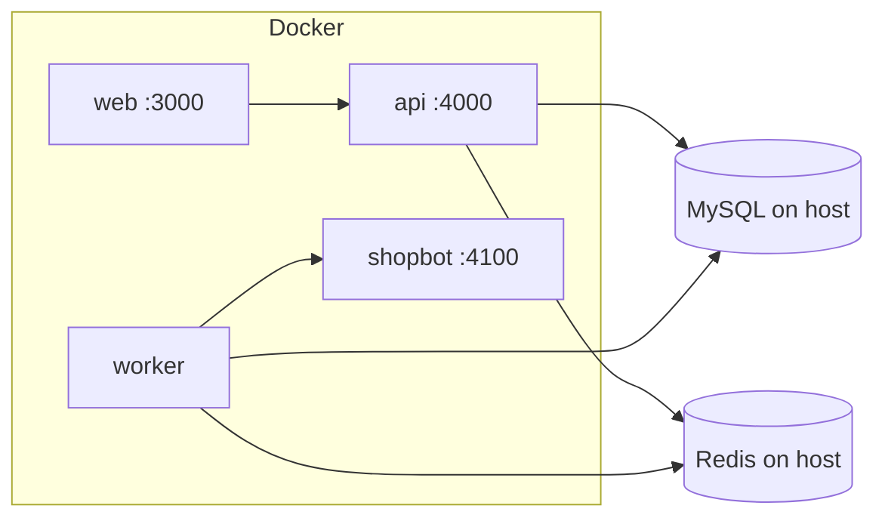

# EvalPilot — Architecture

EvalPilot tests, red-teams and monitors LLM chatbots. A **web app** and a **CLI** start work; an
**API** stores everything and answers fast; a **worker** does the slow part (calling the bot and
the LLM judge); **Redis** carries jobs and live events; **MySQL** keeps the history.

## System

| Part                   | Tech                                                                  | Responsibility                                                                                     |
| ---------------------- | --------------------------------------------------------------------- | -------------------------------------------------------------------------------------------------- |
| `apps/web`             | Next.js 15 App Router, React 19, TanStack Query, Tailwind 4, Recharts | All screens; talks to the API over REST and one Socket.IO connection                               |
| `apps/api`             | NestJS 11, Express, nestjs-zod, Passport, Socket.IO                   | Auth, ownership, validation, CRUD, queueing, realtime gateway, Swagger                             |
| `apps/worker`          | NestJS 11 (no HTTP), BullMQ 5, undici, Anthropic SDK                  | Runs suites, red-team runs and target pings; publishes progress                                    |
| `apps/shopbot`         | Fastify 5                                                             | A demo support bot with planted weaknesses and a "regression" prompt                               |
| `packages/shared`      | zod 4                                                                 | Schemas, response types, check evaluators, attack library, risk score, SSRF rules, CSV, cost table |
| `packages/server-core` | NestJS modules                                                        | Config, Prisma, Redis, queues, secret box, realtime publisher, mappers (shared by API + worker)    |
| `packages/sdk`         | zero-dependency TS                                                    | `trace()` / `record()` with batching, retry and back-off                                           |
| `packages/cli`         | Node                                                                  | `evalpilot run --suite` CI gate with exit codes 0 / 1 / 2                                          |

## Principles

1. **The API never calls a target or the LLM in the request path.** Anything slow becomes a
   BullMQ job and the API answers `202 { runId }`. This keeps request latency flat (trace
   ingestion p95 is 3 ms at 200 rps) and makes the worker the only process that makes outbound
   calls, so the SSRF guard lives in one place.
2. **One schema, four consumers.** Request and response shapes are zod schemas in
   `packages/shared`. The API validates with them (nestjs-zod DTOs, also feeding Swagger), the
   web app's forms use them, and the SDK/CLI types are checked against them at compile time.
3. **Ownership by construction.** Every service method takes the current user and scopes its
   query through the project's `ownerId`. A resource you do not own is indistinguishable from
   one that does not exist: **404**, never 403.
4. **Two kinds of callers.** People use a JWT in an httpOnly `SameSite=Lax` cookie (plus an
   Origin check on mutations against CSRF). Machines use a project API key
   (`Authorization: Bearer ep_live_…`), stored as a SHA-256 hash and shown once.
5. **Everything is traceable.** Each request gets an `x-request-id`, logged with pino and
   returned in every error body, so a user's screenshot of an error maps to one log line.

## Run lifecycle

```mermaid
sequenceDiagram
    participant UI as Web
    participant API
    participant Q as Redis (BullMQ)
    participant WK as Worker
    participant TG as Target
    participant J as Judge
    UI->>API: POST /api/suites/:id/runs
    API->>API: test_run = QUEUED
    API->>Q: add job
    API-->>UI: 202 { runId }
    UI->>API: socket room.join run:<id>
    WK->>Q: take job · run = RUNNING
    loop each case (4 at a time)
        WK->>TG: input (templated body, timeout, SSRF guard)
        TG-->>WK: answer (JSONPath)
        WK->>J: llm_judge / refusal (only if the case uses them)
        WK->>WK: evaluate checks · save test_result
        WK-->>UI: result.created + run.progress (Redis → gateway → room)
    end
    WK->>WK: pass rate vs threshold → PASSED / FAILED
    WK-->>UI: run.completed
```

- Cases run with a concurrency of 4 per run; `WORKER_CONCURRENCY` runs per worker process.
- Results can finish out of order, but **events are published in order** through a serial
  queue per run, so progress always reads 0, 1, 2… and `run.completed` is last.
- **Cancel** marks the run; the worker stops before its next case (in-flight cases finish).
- The run stores cost (target + judge tokens × the cost table), p95 latency and the commit SHA
  sent by the CLI.

## Red-team

The worker sends each attack from the library (26 attacks across prompt injection, jailbreak,
system-prompt leak, PII leak, harmful content and off-topic abuse) to the target and decides
whether it landed with deterministic detectors (canary strings, PII patterns, refusal
heuristics) plus the judge in live mode. The **risk score** (0–100) weights landed attacks by
severity; the level (LOW → CRITICAL) drives the gauge and the threat radar.

## Traces

The SDK batches traces (≤ 100 per request, every 2 s) to `POST /api/v1/traces`. The API stores
them, computes cost, and publishes `trace.created` to the project's room, so the traces page
updates live. Usage charts (requests, errors, p95, cost) are aggregated per bucket for 24 h, 7 d
or 30 d.

## Realtime

One Socket.IO namespace, `/realtime`. The handshake must carry a valid session cookie and an
allowed Origin. Clients join rooms (`run:<id>`, `redteam:<id>`, `project:<id>`) with an ack;
the gateway checks ownership on every join and answers `Not found` otherwise. The worker
publishes to a Redis channel; the API relays to rooms, so any number of API instances can serve
sockets.

## Data model

- Tables are snake_case for MySQL Workbench; ids are cuids.
- History survives edits: a result keeps a snapshot of the case name; deleting a case or target
  sets the foreign key to `NULL` instead of deleting runs.
- Target headers are encrypted with AES-256-GCM (`TARGET_SECRET_KEY`) and masked in responses.

## Security

| Threat                          | Control                                                                                                        | Tested by                                                   |
| ------------------------------- | -------------------------------------------------------------------------------------------------------------- | ----------------------------------------------------------- |
| IDOR                            | owner-scoped queries, 404 for others                                                                           | integration per resource, `e2e/tests/security/idor.spec.ts` |
| SSRF                            | resolved-IP check at connect time (no DNS rebinding), private/metadata/IPv6 ranges, no redirects, http(s) only | `ssrf.spec.ts` (unit), `api-keys-ssrf-secrets.spec.ts`      |
| CSRF                            | SameSite=Lax + Origin allow-list on cookie mutations                                                           | `contracts.spec.ts` (API-08)                                |
| Session theft / forgery         | httpOnly cookie, HS256 only, expiry                                                                            | `auth-tokens.spec.ts`                                       |
| Credential stuffing             | rate limit per IP + email, bcrypt                                                                              | API-10                                                      |
| Secret leakage                  | SHA-256 key hashes, AES-GCM headers, masked responses, pino redaction                                          | SEC-06/07                                                   |
| XSS                             | React escaping only, no raw HTML anywhere                                                                      | `xss.spec.ts`                                               |
| Prompt injection into the judge | outputs fenced in tags and treated as data                                                                     | `prompts.spec.ts`                                           |
| Oversized input                 | 1 MB JSON / 2 MB CSV limits, zod max lengths                                                                   | API-09                                                      |

Helmet headers, a CORS allow-list and request ids are applied in `apps/api/src/app.setup.ts`.

## Deployment

- `docker compose up --build` runs the four services; MySQL and Redis stay on the host and are
  reached through `host.docker.internal` (loopback URLs in `.env` are rewritten for containers).
- The API container applies migrations and seeds the attack library at start.
- Images are multi-stage, run as the non-root `node` user under `tini`, and have health checks
  (the worker's checks its Redis heartbeat).
- Without Docker, `scripts/dev-local.sh` does the same with hot reload.

## Testing

See [TEST_PLAN.md](TEST_PLAN.md): unit and integration (Jest/Vitest, real MySQL + Redis), Pact
contracts for the SDK, CLI and web, Playwright for E2E/API/security/a11y/visual/realtime, k6
for load, and a labelled-set eval for the judge.
