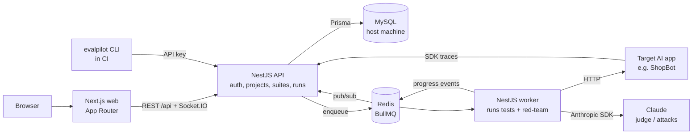
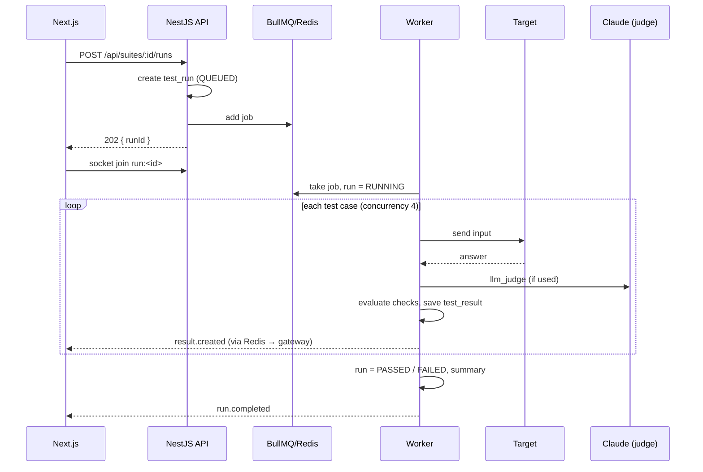

# EvalPilot — Complete Build Specification

> **For the AI/developer building this:** this document is the single source of truth. Build
> everything here, in the order of section 19, inside this repository. Where something is not
> specified, choose the simplest standard option and note it in the README. Do not add anything
> listed in "Out of scope".

---

## 0. Context

| Item | Value |
|---|---|
| Repo | `git@github-personal:SheetalK01/evalpilot.git` (local: `~/Code/evalpilot`) |
| Working branch | `develop`. `main` only gets the final pull request. |
| Owner | Sheetal Khadanga, QA Engineer (Playwright, API, security, accessibility, performance testing; React, Spring Boot). This is her **second** portfolio project; the first is TestPilot AI (Java/Spring + React + Python). |
| Machine | macOS (Apple Silicon) |
| Installed | Node 20 / npm 10, Java 17, Python 3.12, Docker Desktop, **MySQL (Homebrew, 127.0.0.1:3306, auto-starts)**, **Redis (Homebrew, 127.0.0.1:6379, auto-starts)**, MySQL Workbench |
| Database credentials | Already created. Read them from `~/Code/.mysql-local.env` (`DATABASE_URL`, `TEST_DATABASE_URL`, user `evalpilot`, databases `evalpilot` and `evalpilot_test`). Copy the values into the repo's git-ignored `.env`. **Never print, log or commit them.** |
| Git identity | `Sheetal Khadanga <khadangasheetal@gmail.com>` (already set). **Commits and PRs must not contain "Co-Authored-By: Claude" or any AI attribution.** |
| License | All rights reserved (see `LICENSE`). Do not change it. |

**Goal:** a production-quality **full-stack SaaS** with a distinctive, top-notch UI (section 11) that shows strong **TypeScript
full-stack** skills (Next.js, NestJS, real-time, queues, SDK) **and** strong **QA** skills (the
product itself tests AI, and the codebase is thoroughly tested). Recruiters and interviewers for
both Full Stack and QA/SDET roles will open this repo.

---

## 1. Product

**EvalPilot — "Test your AI before your users do."**

Companies ship AI chatbots and assistants, but AI answers change with every prompt or model update,
can be wrong or made up, and can be attacked with prompt injection. EvalPilot is a platform to
**test, red-team and monitor** AI apps:

1. Connect an AI app (an HTTP endpoint, or the built-in demo chatbot **ShopBot**).
2. Write **test suites**: inputs plus expected behaviour (rules or an AI judge).
3. **Run** them; results stream in live; compare runs to catch regressions.
4. **Red-team** the app with a library of attack prompts and get a risk report.
5. **Trace** production traffic through a small SDK: latency, cost, errors, every conversation.
6. **Gate CI**: a CLI fails the build when quality drops below a threshold.

**Pitch for interviews:** *"TestPilot uses AI for testing. EvalPilot tests AI."*

---

## 2. Scope

### In scope (must build)
1. Landing page; sign up / log in / log out (email + password); optional GitHub OAuth (enabled only when env vars are set)
2. Projects (owner-scoped) and per-project **API keys** (create, list masked, revoke)
3. **Targets**: HTTP target (URL, method, headers, body template with `{{input}}`, JSON path to the answer, timeout) and the built-in **ShopBot** demo target
4. **Test suites & test cases** with checks (section 8), CSV import/export
5. **Test runs** in a background queue with **live progress over WebSockets**, results, run comparison
6. **Red-team runs** from a seeded attack library, with findings, severity and a risk score
7. **Traces**: ingestion API + **TypeScript SDK**; live traces feed; trace detail; usage dashboard (requests, p95 latency, error rate, tokens, estimated cost)
8. **CLI / CI gate** (`evalpilot run`) + an example GitHub Actions workflow
9. Dashboard with charts
10. **ShopBot** demo chatbot (separate small service) instrumented with the SDK
11. Mock AI mode (deterministic, free) for judge, red-team and ShopBot
12. Swagger / OpenAPI docs
13. Tests at every layer (section 12), CI, Docker
14. Docs: README, API, TEST_PLAN, INTERVIEW_NOTES, ARCHITECTURE

### Out of scope (do NOT build)
- Teams / organisations / roles beyond project owner; invitations
- Billing, payments, email sending, notifications (Slack etc.)
- Fine-tuning, embeddings, vector databases, RAG
- Running untrusted user code; plugins
- Mobile app; Kubernetes; paid infrastructure

---

## 3. Tech stack (exact versions, commit lock files)

| Layer | Choice |
|---|---|
| Language | **TypeScript** everywhere (strict mode) |
| Monorepo | **npm workspaces** (`apps/*`, `packages/*`) |
| Frontend | **Next.js 15 (App Router)**, React 19, Tailwind CSS v4, **shadcn/ui**, lucide-react, Recharts, TanStack Query, socket.io-client, react-hook-form + zod |
| Backend | **NestJS 11**, REST + **Socket.IO gateway**, class-validator, Passport (JWT + local + GitHub), `@nestjs/swagger`, pino logging |
| Queue / worker | **BullMQ** on **Redis**; the worker is a separate NestJS app sharing the domain modules |
| Database | **MySQL 8+** (the Homebrew MySQL on this Mac) with **Prisma** ORM and **Prisma Migrate** |
| AI | Official **Anthropic TypeScript SDK** (`@anthropic-ai/sdk`), model id **`claude-opus-5-5`** (env `ANTHROPIC_MODEL`); mock mode |
| SDK & CLI | `packages/sdk` (`@evalpilot/sdk`), `packages/cli` (`evalpilot`), built with tsup |
| Shared | `packages/shared`: zod schemas and types used by API, worker, web, SDK, CLI |
| QA | Jest (backend), Vitest + Testing Library (frontend, packages), **Playwright** (E2E, API, a11y via `@axe-core/playwright`, visual), **Pact** (consumer-driven contract tests), **k6** (load) |
| Quality | ESLint + Prettier, Husky + lint-staged pre-commit, coverage ≥ 80% on backend services and packages |
| DevOps | Docker (multi-stage, non-root), docker-compose, GitHub Actions |

---

## 4. Local data rule (important)

The owner wants to **see all data in MySQL Workbench** and wants the **same data whether the app runs
with Docker or without it**.

- All app data lives in the **Homebrew MySQL on this Mac** (`evalpilot` database). Tests use the
  separate `evalpilot_test` database and reset it per test run.
- **Do not add a MySQL or Redis container to docker-compose.** Docker services connect to the host:
  `DATABASE_URL=mysql://…@host.docker.internal:3306/evalpilot`,
  `REDIS_URL=redis://host.docker.internal:6379`. Locally without Docker:
  `127.0.0.1:3306` and `127.0.0.1:6379`.
- `.env.example` documents both forms with placeholders; the real `.env` is git-ignored.
- **CI is different:** GitHub Actions uses MySQL and Redis *service containers* (the runner has no
  host MySQL). That is fine and must be documented.
- Prisma migrations are the only way the schema changes. Name tables in `snake_case` with
  `@@map`, so they read well in Workbench.

---

## 5. Architecture



**Principles**
- The **API never calls targets or Claude in the request path.** Long work goes to the worker via
  BullMQ; the API returns `202` with a run id.
- The worker publishes progress to Redis pub/sub; the API's Socket.IO gateway relays it to clients in
  a room per run (`run:<id>`) and per project (`project:<id>` for live traces).
- **Two auth modes:** users (JWT in an httpOnly cookie) and machines (project API key in
  `Authorization: Bearer ep_live_…`, used by SDK and CLI). API keys are stored as SHA-256 hashes; only
  the prefix is shown after creation.
- Every request has a **request ID** (`x-request-id`), included in logs and in error responses.
- **Ownership:** every query is scoped by `ownerId`; another user's resource returns **404**.

### Run lifecycle


---

## 6. Repository layout

```
evalpilot/
├── apps/
│   ├── api/            NestJS API (REST + Socket.IO)
│   │   └── src/ auth/ users/ projects/ api-keys/ targets/ suites/ test-cases/ runs/
│   │            redteam/ traces/ dashboard/ realtime/ common/ config/ prisma/
│   ├── worker/         NestJS worker (BullMQ processors: test-runs, redteam)
│   ├── web/            Next.js app
│   └── shopbot/        Demo chatbot (small NestJS or Fastify service) using the SDK
├── packages/
│   ├── shared/         zod schemas, types, check evaluators (pure functions)
│   ├── sdk/            @evalpilot/sdk (tracing)
│   └── cli/            evalpilot CLI (CI gate)
├── prisma/             schema.prisma, migrations/, seed.ts (attack library + demo data)
├── e2e/                Playwright: pages/ fixtures/ tests/{ui,api,a11y,visual,realtime}/
├── contracts/          Pact consumer tests (SDK, CLI, web) + provider verification
├── perf/               k6 scripts
├── docs/               BUILD_SPEC.md, ARCHITECTURE.md, API.md, TEST_PLAN.md, INTERVIEW_NOTES.md, screenshots/
├── scripts/            dev-local.sh, reset-test-db.sh, capture-screenshots.ts
├── .github/workflows/  ci.yml, evalpilot-gate.example.yml
├── docker-compose.yml  api, worker, web, shopbot (NO database/redis containers)
├── .env.example, LICENSE, README.md, package.json (workspaces)
```

---

## 7. Database (Prisma + MySQL)

All ids are `cuid()` strings. Every table has `created_at`; mutable tables have `updated_at`.
Indexes on every foreign key and on the listed query fields. Deleting a project cascades to its
children.

| Table | Columns (main) | Notes |
|---|---|---|
| `users` | id, name, email (unique, lower-case), password_hash (nullable for OAuth), github_id (unique, nullable), avatar_url | bcrypt hashes |
| `projects` | id, owner_id → users, name, description | owner-scoped |
| `api_keys` | id, project_id, name, prefix (e.g. `ep_live_ab12`), key_hash (sha256, unique), last_used_at, revoked_at | raw key shown once |
| `targets` | id, project_id, name, type (`HTTP` \| `SHOPBOT`), url, method, headers_json, body_template, response_path, timeout_ms | headers may hold secrets: encrypt at rest (AES-256-GCM with `TARGET_SECRET_KEY`) and never return them in full |
| `test_suites` | id, project_id, target_id, name, description, pass_threshold (0–1, default 0.9) | |
| `test_cases` | id, suite_id, name, input (TEXT), checks_json (array, validated by zod), tags, position | |
| `test_runs` | id, suite_id, status (`QUEUED` \| `RUNNING` \| `PASSED` \| `FAILED` \| `ERROR` \| `CANCELLED`), trigger (`UI` \| `CLI` \| `API`), commit_sha, total, passed, failed, pass_rate, avg_latency_ms, total_tokens, est_cost_usd, started_at, finished_at, error | indexed by suite + created_at |
| `test_results` | id, run_id, test_case_id, status (`PASSED` \| `FAILED` \| `ERROR`), output (TEXT), latency_ms, tokens, check_results_json, judge_score, judge_reason | |
| `attacks` | id, category, name, prompt, detection_json, severity (`LOW` \| `MEDIUM` \| `HIGH` \| `CRITICAL`) | seeded library (≥ 24 attacks, 6 categories) |
| `redteam_runs` | id, project_id, target_id, status, total, vulnerable, risk_score (0–100), started_at, finished_at | |
| `redteam_findings` | id, redteam_run_id, attack_id, output, vulnerable (bool), evidence, severity | |
| `traces` | id, project_id, external_id, name, input, output, model, latency_ms, input_tokens, output_tokens, est_cost_usd, status (`OK` \| `ERROR`), error, metadata_json, started_at | indexed by project + started_at |

---

## 8. Checks (how a test case passes)

`checks_json` is an array; a test case passes when **all** checks pass. Implement the evaluators as
pure functions in `packages/shared` (unit-tested) except `llm_judge`.

| type | config | passes when |
|---|---|---|
| `contains` | `value`, `caseSensitive?` | output includes value |
| `not_contains` | `value` | output does not include value |
| `equals` | `value` | exact match (trimmed) |
| `regex` | `pattern`, `flags?` | regex matches (guard against catastrophic patterns: timeout or length limit) |
| `json_schema` | `schema` | output parses as JSON and validates (Ajv) |
| `max_length` | `chars` | output length ≤ chars |
| `latency` | `maxMs` | response time ≤ maxMs |
| `refusal` | `expected: true \| false` | the answer refuses (or does not) — heuristic + judge in live mode |
| `llm_judge` | `criteria` (text), `threshold` (1–10) | Claude scores the answer against the criteria with structured JSON output `{score, reason}`; score ≥ threshold |

Mock mode for `llm_judge`: deterministic score from simple rules (e.g. keywords in criteria found in
output), clearly labelled `mock` in results.

---

## 9. API (NestJS, base `/api`)

JSON camelCase. Errors: `{ statusCode, message, errors?, path, requestId, timestamp }`. Swagger at
`/api/docs`. Pagination: `?cursor=&limit=` (max 100).

| Area | Endpoints |
|---|---|
| Auth | `POST /auth/register`, `POST /auth/login`, `POST /auth/logout`, `GET /auth/me`, `GET /auth/github` + callback (only when configured) |
| Projects | `GET/POST /projects`, `GET/PATCH/DELETE /projects/:id` |
| API keys | `GET/POST /projects/:id/api-keys`, `DELETE /api-keys/:id` (revoke) |
| Targets | `GET/POST /projects/:id/targets`, `GET/PATCH/DELETE /targets/:id`, `POST /targets/:id/ping` (one test call) |
| Suites | `GET/POST /projects/:id/suites`, `GET/PATCH/DELETE /suites/:id`, `GET /suites/:id/export.csv`, `POST /suites/:id/import` (CSV) |
| Test cases | `GET/POST /suites/:id/cases`, `PATCH/DELETE /cases/:id`, `POST /suites/:id/cases/reorder` |
| Runs | `POST /suites/:id/runs` → 202, `GET /suites/:id/runs`, `GET /runs/:id`, `GET /runs/:id/results`, `POST /runs/:id/cancel`, `GET /runs/:id/compare/:otherId` |
| Red-team | `GET /attacks`, `POST /targets/:id/redteam` → 202, `GET /projects/:id/redteam-runs`, `GET /redteam-runs/:id` (+ findings) |
| Traces (API key) | `POST /v1/traces` (single or batch ≤ 100), `GET /projects/:id/traces`, `GET /traces/:id`, `GET /projects/:id/usage?range=24h\|7d\|30d` |
| CLI (API key) | `POST /v1/suites/:id/runs` → 202, `GET /v1/runs/:id` |
| Dashboard | `GET /dashboard` (counts, pass-rate trend, latest red-team score, cost trend, recent runs) |
| Health | `GET /health` (DB + Redis) |

**WebSocket events** (Socket.IO namespace `/realtime`, cookie auth; join only rooms you own):
`run.progress {runId, done, total}`, `result.created {result}`, `run.completed {run}`,
`redteam.finding {finding}`, `redteam.completed {run}`, `trace.created {trace}`.

**Rate limits:** auth endpoints and `/v1/*` with `@nestjs/throttler`.

---

## 10. Worker, red-team, ShopBot, SDK, CLI

### Worker
- Queues `test-runs` and `redteam`; per-run concurrency 4; per-call timeout from the target;
  retries 2 with backoff for network errors only; a run that throws is `ERROR` with a message.
- Cancel support (checked between cases). Idempotent result writes.
- Calls targets with the body template (`{{input}}` replaced, JSON-escaped), reads the answer via
  the JSON path. Blocks private/internal IPs for HTTP targets unless `ALLOW_PRIVATE_TARGETS=true`
  (SSRF protection; ShopBot and localhost allowed in dev).

### Red-team
- Seeded **attack library** (≥ 24) in 6 categories: prompt injection, jailbreak, system prompt
  leak, PII leak, harmful content, off-topic/abuse. Each attack has detection rules (e.g. canary
  string revealed, refusal missing) plus an LLM-judge verdict in live mode.
- Risk score 0–100 weighted by severity. Findings show the attack, the answer, evidence and a fix tip.

### ShopBot (demo target)
- A tiny customer-support bot for a fake shop ("ShopSphere"): refund policy (30 days), shipping,
  order status (fake data), with a system prompt containing a **canary secret** for leak tests.
- Live mode uses Claude; **mock mode** returns deterministic answers and deliberately fails a few
  red-team attacks so the demo shows findings.
- Sends traces to EvalPilot with the SDK.

### SDK (`@evalpilot/sdk`)
```ts
const ep = new EvalPilot({ apiKey: process.env.EVALPILOT_API_KEY, baseUrl })
const answer = await ep.trace('shopbot.chat', { input, model }, async () => callLLM(input))
```
- Batches and flushes traces (interval + size), never throws into the host app, retries with
  backoff, and has `flush()` / `shutdown()`. Typed with `packages/shared`.

### CLI (`evalpilot`)
- `evalpilot run --suite <id> --threshold 0.9 [--wait] [--json]`, exits non-zero below threshold
  or on error; prints a results table; reads `EVALPILOT_API_KEY` and `EVALPILOT_URL`.
- `.github/workflows/evalpilot-gate.example.yml` shows how a customer repo would use it.

---

## 11. Frontend (Next.js)

### Design direction: "Flight Deck" (must look unlike a generic SaaS template)

EvalPilot must have its **own visual identity**. It must NOT look like the owner's other projects
(TestPilot AI, her portfolio) or like a default shadcn/Tailwind dashboard. The idea: **an aircraft
cockpit / flight recorder for AI.** Every screen should feel like a precise instrument panel:
calm, dense, technical and premium (think Teenage Engineering, Linear and an avionics display).

**Banned (do not use):** indigo/violet/pink gradients, glassmorphism and blur cards, blob or mesh
gradient backgrounds, big soft drop shadows, rounded-2xl "bubbly" cards, Inter as the only font,
emoji icons, stock illustrations, generic "3 feature cards with icons" sections, unmodified
shadcn default theme.

**Colour tokens** (CSS variables, used everywhere; no hard-coded colours):
| Token | Dark ("night flight", default) | Light ("paper chart") |
|---|---|---|
| `--bg` | `#0B0D0C` near-black graphite | `#F3F1EA` warm paper |
| `--panel` | `#121614` | `#FBFAF6` |
| `--line` (hairlines, 1px) | `#232A26` | `#D9D5C8` |
| `--text` / `--muted` | `#E8ECE6` / `#7C877F` | `#151816` / `#6B6F66` |
| `--signal` (brand accent) | `#D4FF3A` radar lime | `#4B6B00` deep olive |
| `--pass` / `--fail` / `--warn` / `--info` | `#3DDC97` / `#FF5A36` / `#FFB020` / `#5AC8FA` | darker AA-contrast versions |

Colour carries **meaning** only: lime = brand/primary action, green = pass, orange-red = fail,
amber = warning/medium risk, cyan = running/live. Everything else is greyscale.

**Typography:** display/headings **Space Grotesk** (tight tracking), UI text **IBM Plex Sans**,
all numbers, ids, latencies, code and labels **IBM Plex Mono** with `tabular-nums`. Small
uppercase mono labels (`LATENCY P95`, `PASS RATE`) above every value, like instrument readouts.

**Signature elements (build all of them):**
1. **Hairline grid layout:** panels separated by 1px lines, square corners (radius 4px max), small
   crosshair `+` marks on panel corners, faint dotted grid on the page background.
2. **Status bar (top, every app page):** cockpit-style strip showing `API ● DB ● REDIS ● WORKER`
   health LEDs (from `/health`), UTC clock, current project, and `⌘K` hint.
3. **Command palette (`⌘K`)** for navigation and actions (run suite, start red-team, create key,
   switch theme); the whole app is usable from the keyboard (`g d` dashboard, `r` run, `?` shortcuts).
4. **Run "flight strip":** on the live run page each test case is a thin vertical tick on a
   horizontal timeline that lights up green/red as results stream in (with a scanning cyan cursor
   while running), above the results table. The same strip, small, appears in run lists as a
   sparkline-like history.
5. **Altimeter numbers:** key numbers (pass rate, risk score) animate with a rolling digit counter.
6. **Threat radar:** red-team report shows a polar/radar chart of the 6 attack categories with a
   rotating sweep line while the run is live; findings are listed like an incident log
   (`[CRITICAL] 14:02:11 PROMPT_INJECTION …`).
7. **Trace "black box" feed:** live traces scroll like a flight recorder log in monospace rows with
   latency bars; clicking one opens a split-pane inspector (input / output / metadata / timing
   waterfall).
8. **Run diff view:** two runs side by side with changed cases highlighted (`PASS → FAIL` in red,
   `FAIL → PASS` in green), like a code diff.
9. **Landing page hero:** not a gradient blob. A large live **instrument panel demo** that
   auto-plays a real-looking run against ShopBot (flight strip filling up, readouts rolling, a
   red-team finding appearing), with the headline in Space Grotesk on the left. Sections below use
   asymmetric editorial layouts, a terminal block for the CLI, a code block for the SDK, and a
   "before / after EvalPilot" comparison — no generic icon-card grids.
10. **Logo:** a minimal mark combining an attitude-indicator horizon line and a check, in
    `--signal`; mono wordmark `EVALPILOT`.

**Motion:** fast and mechanical (120–200 ms, ease-out, no bounce); streaming rows slide in; LEDs
pulse softly when live. All motion off under `prefers-reduced-motion`.

**Components:** shadcn/ui is allowed only as the accessible base; **restyle every component** with
the tokens above (square, hairline, mono labels). Icons: lucide at 1.5px stroke, used sparingly.
Charts: Recharts restyled (no chart junk, hairline axes, mono ticks, meaning colours).

**States:** skeletons shaped like the real content with a scanning line; empty states are a
short instruction plus a single action and a small line-art instrument drawing (SVG, drawn in
code); errors show the `requestId` in mono with a copy button.

**Quality:** WCAG 2.1 AA in both themes (check `--muted` and status colours for contrast), visible
lime focus rings, keyboard navigation everywhere, responsive from 360px (status bar collapses to
LEDs only). Theme toggle remembered and respects the system setting. Build a `/app/design`
page (dev only) showing all tokens and components, used by the visual tests.

### Pages
| Route | Content |
|---|---|
| `/` | Landing: hero ("Test your AI before your users do"), **animated live run** (test results streaming in), features (Suites, Red-team, Traces, CI gate), how it works, code snippet of the SDK and the CLI, footer links to GitHub + portfolio `https://sheetalk01.github.io` |
| `/login`, `/register` | Auth with GitHub button (shown only if configured) |
| `/app` | Dashboard: stat cards, pass-rate trend (line), latest red-team risk (gauge), cost/latency (area), recent runs |
| `/app/projects/[id]` | Overview with tabs: Targets, Suites, Red-team, Traces, Settings (API keys) |
| `/app/suites/[id]` | Test case table editor (add, edit in drawer with check builder, reorder, CSV import/export), Run button |
| `/app/runs/[id]` | **Live run view**: progress bar, results streaming in, filter failed, expand to see output + each check, compare with previous run (diff of statuses) |
| `/app/redteam/[id]` | Risk score, category breakdown, findings list with severity badges |
| `/app/projects/[id]/traces` | Live traces feed, search/filter, trace drawer, usage charts |
| `/app/settings` | Profile, API keys, CI setup guide with copyable snippets |

### Required `data-testid`s
Add stable `data-testid`s for every interactive element and every list row (e.g. `login-email`,
`register-submit`, `project-card`, `new-suite-button`, `case-row`, `check-type-select`,
`run-button`, `run-progress`, `result-row`, `result-status`, `filter-failed`, `compare-button`,
`redteam-start`, `risk-score`, `finding-row`, `trace-row`, `api-key-create`, `api-key-value`,
`theme-toggle`, `toast`). List them all in `docs/TEST_PLAN.md`.

---

## 12. QA automation (the owner's core skill — make it shine)

| Layer | Tool | Must cover |
|---|---|---|
| Unit | Jest / Vitest | every check evaluator, risk scoring, cost calculation, SDK batching/retry, CLI exit codes, CSV parser, SSRF guard |
| Integration | Jest + Supertest against `evalpilot_test` (MySQL) + Redis | auth, ownership (**IDOR → 404**), API keys (hashing, revoke), suites/cases CRUD + validation, run creation → queue job, worker processing with a fake target, red-team scoring, traces ingestion + usage aggregation |
| Contract | **Pact** | SDK ↔ `/v1/traces`, CLI ↔ `/v1/runs`, web ↔ key API endpoints; provider verification in CI |
| Real-time | Playwright + socket.io-client | live results arrive in order; a user cannot join another user's run room |
| E2E | Playwright (POM, fixtures, tags `@smoke @regression @security @a11y @visual @realtime`) | register → project → target (ShopBot) → suite with 5 cases → run → live results → compare; red-team → findings; SDK traces appear live; API key create/revoke; CSV import/export |
| API | Playwright `request` | status codes, schemas, error format, pagination, rate limits |
| Security | Playwright + Jest | IDOR, tampered/expired JWT, revoked API key, SSRF blocked, XSS payloads in test case names/outputs rendered safely, secrets never returned |
| Accessibility | `@axe-core/playwright` | every page, light + dark: zero serious/critical violations |
| Visual | Playwright snapshots | landing, dashboard, run view, red-team report |
| Load | **k6** | trace ingestion 200 rps for 60 s (p95 < 300 ms, errors < 1%); 20 concurrent runs |
| AI quality | eval script | judge consistency on a labelled set (agreement %) in live mode; documented |

- Each test creates its own user/project; tests run in parallel and reset `evalpilot_test`.
- Coverage ≥ 80% (API services, worker processors, packages). Report in CI.
- `docs/TEST_PLAN.md` written like a QA lead: strategy (test pyramid), scope, environments, entry/exit
  criteria, risks, test case table (ID, title, suite, type, priority, automated, spec file).

---

## 13. Security checklist
- bcrypt passwords; JWT in httpOnly, `SameSite=Lax`, `Secure` in production; CSRF protection for
  cookie-auth mutations (double-submit token or SameSite + Origin check).
- API keys hashed (sha256), shown once, revocable; prefix only in UI.
- Target headers encrypted at rest; masked in responses.
- Owner checks everywhere (404 for others); WebSocket room authorisation.
- SSRF guard for HTTP targets; request size limits; rate limiting; helmet headers; CORS allow-list.
- Validation on every input (class-validator + zod); Prisma only (no raw SQL with user input).
- No secrets in git; `.env` git-ignored; never log secrets or full API keys.

---

## 14. Configuration (`.env.example`)
`NODE_ENV`, `API_PORT=4000`, `WEB_URL=http://localhost:3000`, `SHOPBOT_PORT=4100`,
`DATABASE_URL` (local `127.0.0.1`, Docker `host.docker.internal`), `TEST_DATABASE_URL`,
`REDIS_URL`, `JWT_SECRET`, `TARGET_SECRET_KEY` (32-byte base64), `AI_MODE=mock`,
`ANTHROPIC_API_KEY`, `ANTHROPIC_MODEL=claude-opus-5-5`, `GITHUB_CLIENT_ID`/`SECRET` (optional),
`ALLOW_PRIVATE_TARGETS=true` (dev), `EVALPILOT_API_KEY`/`EVALPILOT_URL` (ShopBot, CLI).

---

## 15. DevOps
- Dockerfiles for api, worker, web, shopbot (multi-stage, non-root, healthchecks).
- `docker-compose.yml`: those four services only, `extra_hosts: ["host.docker.internal:host-gateway"]`,
  `.env`-driven; **no MySQL/Redis containers** (section 4).
- `scripts/dev-local.sh`: runs migrations, seeds, and starts api + worker + web + shopbot without
  Docker; Ctrl+C stops all.
- GitHub Actions `ci.yml`: lint/typecheck → unit → integration (MySQL + Redis service containers) →
  contract (Pact) → build → E2E (all Playwright projects, mock AI) → k6 smoke; upload reports and
  coverage; badges in README.
- Free deployment is **optional and later**; document a plan in README (no paid services).

---

## 16. Documentation
- **README**: logo banner, badges, one-line pitch, demo GIF + screenshots (light/dark), "Why I built
  this" (QA engineer + AI testing gap), features, architecture diagram, tech stack, quick start
  (with and without Docker, using the local MySQL + Redis), SDK and CLI usage, how to run every test
  suite, project structure, roadmap, author section with LinkedIn
  `https://www.linkedin.com/in/sheetal-khadanga`, GitHub `https://github.com/SheetalK01`, portfolio
  `https://sheetalk01.github.io`. License section: all rights reserved.
- **docs/ARCHITECTURE.md**, **docs/API.md**, **docs/TEST_PLAN.md**.
- **docs/INTERVIEW_NOTES.md**: design decisions and why (NestJS modules, queue vs request path,
  WebSockets via Redis pub/sub, API key hashing, SSRF guard, LLM-as-judge trade-offs, mock mode,
  contract testing, test pyramid), what would change at scale, and **20 likely interview questions
  with short answers** for both Full Stack and QA/SDET interviews.

---

## 17. Quality bar
- Clean module boundaries, DTOs/zod at every edge, no `any`, small functions, meaningful names.
- Loading, empty and error states on every screen; no console errors.
- Lint, typecheck and all tests green; coverage targets met.
- A stranger can run it from a fresh clone in under 10 minutes by following the README.

---

## 18. Rules for the builder
- Work on `develop`; commit after each phase with clear messages; push.
- **No "Co-Authored-By: Claude" or other AI attribution in commits or PRs.**
- Never print or commit credentials; read DB credentials from `~/Code/.mysql-local.env` into `.env`.
- Before writing Anthropic SDK code, check the current TypeScript SDK docs for exact parameters.
- Use mock AI for all tests and CI. The owner adds a real key later.
- Quality over speed: finish and polish before adding more.

---

## 19. Build order

| Phase | Work | Done when |
|---|---|---|
| 1 | Monorepo, tooling, `packages/shared`, Prisma schema + first migration on local MySQL, seed (attack library + demo user/project/ShopBot target/suite) | `npm run typecheck`, `npx prisma migrate dev` OK; tables visible in Workbench |
| 2 | API: auth, projects, API keys, targets, suites, cases (CRUD, validation, ownership, Swagger) + tests | unit + integration green |
| 3 | Worker + queues + runs + checks + LLM judge (mock/live) + real-time gateway + red-team + tests | green; a run streams results over WebSocket |
| 4 | ShopBot, SDK, traces ingestion + usage, CLI + CI gate example + tests (incl. Pact) | green |
| 5 | Web: design system, landing, auth, dashboard, project tabs, suite editor, live run view, red-team report, traces, settings | lint + build green; manual smoke via `scripts/dev-local.sh` |
| 6 | QA: Playwright (E2E, API, security, a11y, visual, realtime), k6, TEST_PLAN | all green locally |
| 7 | Docker, compose (host MySQL/Redis), CI workflow | CI green on GitHub |
| 8 | Docs, screenshots/GIF, INTERVIEW_NOTES, polish | fresh-clone run verified |

Finish with a pull request **develop → main** titled "EvalPilot v1.0" (no AI attribution). Do not
merge it.

---

## 20. Definition of done
- [ ] All CI jobs green; lint, typecheck, unit, integration, contract, E2E, a11y, visual pass locally
- [ ] Coverage ≥ 80% on API services, worker processors and packages
- [ ] Zero serious/critical axe violations
- [ ] App works end to end via `scripts/dev-local.sh` **and** `docker compose up`, with data in the
      host MySQL `evalpilot` database (visible in MySQL Workbench)
- [ ] ShopBot demo shows a passing suite, a regression after a prompt change, and red-team findings
- [ ] SDK traces appear live; CLI gate fails below threshold
- [ ] README lets a stranger run it in under 10 minutes; screenshots in light and dark
- [ ] No secrets committed; no AI attribution in commits
